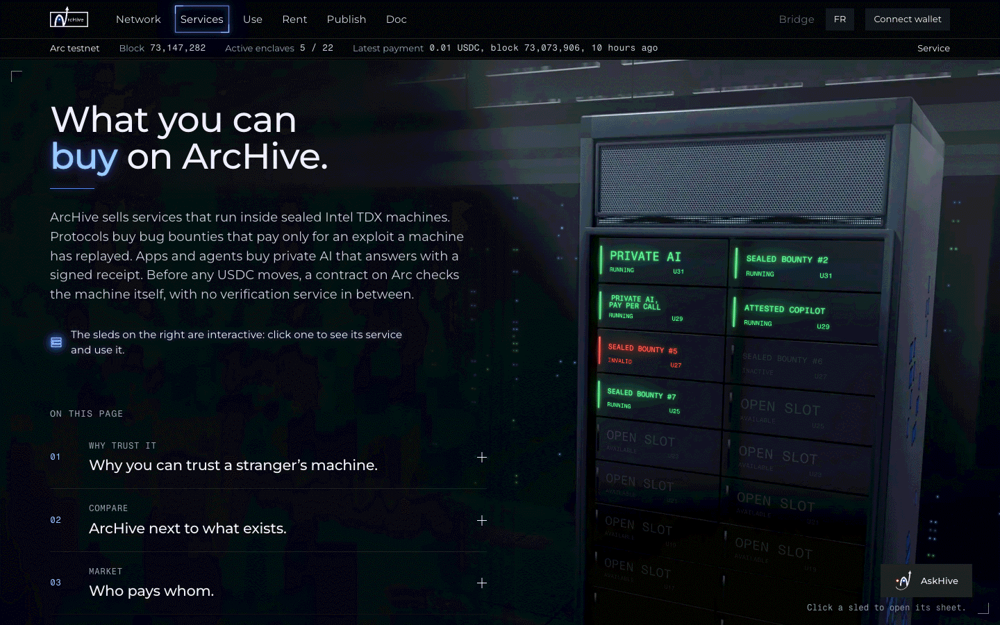

# ArcHive

**Sealed machines, open market.** ArcHive is a marketplace of services that run inside Intel TDX enclaves. Before any
result counts, a contract on **Arc** checks Intel's signature on the machine and the exact image it runs; every use is
**paid in USDC** against a receipt the enclave signed, and a machine caught lying loses its operator's USDC bond.

**The problem.** An app or an AI agent that sends a private request to someone else's machine, or pays out on a
security report, has to take the provider's word: that the advertised code is what runs, that the data stays private,
that the result is honest. ArcHive replaces that word with checks Arc runs itself: a machine is admitted only once
Intel's signature and its image fingerprint check out, USDC is paid out only against a signature from an admitted
enclave, and a proven lie costs the operator's bond.

Built on Arc testnet for UBC 2026 (Track 01, Agentic Payments & AI, and the Arc chain award) by Jean-Baptiste Durand
and Florent Belotti.

<p>
  
  
</p>

The home page and the Services page of https://arc-hive.xyz on 20 Nov 2026. On the Services page, each named sled of the
rack is a product with its live state; the others are open slots.

## Live

| What | Link |
|---|---|
| The marketplace | https://arc-hive.xyz |
| How it works in 3D (roles, contracts, a guided demo) | https://arc-hive.xyz/network.html |
| The services, prices and shares | https://arc-hive.xyz/service.html |
| The Doc: how Arc checks every machine, every proof linked | https://arc-hive.xyz/doc.html |
| Bring USDC to Arc with Circle's CCTP (from Ethereum Sepolia or Base Sepolia) | https://arc-hive.xyz/bridge.html |
| Console (sessions, bounties, operators, developers) | https://archive.62-171-153-35.sslip.io/console/ |
| 3D server room (live, or a replay of recorded events) | https://arc-hive.xyz/datacenter/ |
| Read API (JSON, no key) | https://arc-hive.xyz/api/stats |
| MCP server for AI agents (16 tools, no key) | https://arc-hive.xyz/mcp |
| Arc testnet explorer | https://explorer.testnet.arc.io |

The same site also answers at the server's own address, https://archive.62-171-153-35.sslip.io, where the console and
the operators' wallet sign-in run (https://arc-hive.xyz/console/ redirects there).

## Check it in two minutes, no wallet needed

1. **What runs now**, and the key of each enclave Arc admitted:
   `curl -s https://arc-hive.xyz/api/enclaves`
2. **Arc's admission check, replayed for you**: on the home page, section *Arc check* ("Arc admits the enclave or
   refuses it"), press **Change one byte**. Arc recomputes the image fingerprint (a read-only call) and refuses the machine.
3. **Ask AskHive** (bottom right of the site) *"Does this chat run in an enclave?"*. The panel shows its connection to
   the enclave whose key Arc holds for product 4, and the answer comes back sealed by that enclave.
4. **Open any transaction below** on the explorer: `https://explorer.testnet.arc.io/tx/<hash>`.
5. **Without a browser** (Foundry's `cast`):
   `cast receipt 0xde9628b23d0483bb666a0cd13c55c4f32a1204151323a80da9451b0aeb330176 --rpc-url https://rpc.testnet.arc.io`
   shows AskHive's enclave admission: status 1 (success), 6,849,074 gas, sent to the `EnclaveRegistry`.

## AskHive: the site's assistant, in its own enclave

AskHive explains ArcHive while it shows it: it opens pages, highlights what it talks about, plays the 3D demo of the
Network page and walks you through a task step by step. It prepares operations (a prepaid session, an operator bond, a
bounty, a new product) that **you sign in your own wallet**: it holds no key and has no tool that spends.

AskHive runs in its own Intel TDX enclave, registered on Arc as **product 4** (free):

- **Before sending anything**, the panel reads the enclave's keys (`/enclave/copilot-site/pubkeys`) and checks on Arc
  that this key is registered for product 4, with an image the product allows and an operator that is not banned.
- **The conversation is sealed** to that key (HPKE). The web server in between relays ciphertext only.
- **The answer comes back sealed** to the visitor's request: only the enclave holding the key checked on Arc can
  produce it. The enclave also signs each answer (`ARC-COPILOT-SITE-REPLY-v1`; the verifier is `verifySiteReply` in
  [`enclave-site.ts`](services/copilot/src/enclave-site.ts)).
- **If a check fails**, the panel says so and uses the copilot on the site's server; a sealed conversation is never
  resent in clear.
- **The model** (`gpt-oss-120b`) runs at RedPill behind an attested gateway that the enclave verifies before any call
  (Intel quote, production OS, pinned TLS, signed receipts). It does not run inside ArcHive's enclave.
- **What the operator cannot change**: the compose ([`enclave/phala/copilot-site-v22.yml`](enclave/phala/copilot-site-v22.yml),
  the file measured on Arc, byte for byte) pins the image by its digest (the code and the prompt) and writes the model,
  its URL and the limits in clear, so all of it is part of the image fingerprint Arc allows for product 4.

| Proof (Arc testnet, 19 Nov 2026, UTC) | Transaction |
|---|---|
| Image fingerprint `0x5771d334…ebe0` proposed, then allowed for product 4 (22:28) | [`0xc45eac78…ed28`](https://explorer.testnet.arc.io/tx/0xc45eac7898951503904d1a7b51acc415aac12ed5a40ee9eb4bcc2fe86122ed28), [`0x93f11a27…9228`](https://explorer.testnet.arc.io/tx/0x93f11a27c647d089e161acaaa60bf3ae3091e609773492b50326efbfc2a09228) |
| AskHive's enclave admitted through Intel DCAP, key `0x09061F21A5b938cD941ea9eDfa481f89DEb716Ac` (22:37, 6,849,074 gas) | [`0xde9628b2…0176`](https://explorer.testnet.arc.io/tx/0xde9628b23d0483bb666a0cd13c55c4f32a1204151323a80da9451b0aeb330176) |
| Its enclave bound to its chip, for the verified level (22:38) | [`0x469706cb…111c`](https://explorer.testnet.arc.io/tx/0x469706cb81f090b0205c52a20f7739af3d544a8f869f2d0fd09bb8816312111c) |

Code: the panel in [`frontend/src/copilot/`](frontend/src/copilot/), the service in
[`services/copilot/`](services/copilot/) (signed replies: [`enclave-site.ts`](services/copilot/src/enclave-site.ts)),
the contract between them in [`docs/COPILOT-SITE-CONTRACT.md`](docs/COPILOT-SITE-CONTRACT.md).

## Use ArcHive from your own tools

### The MCP server, in Claude Code, Cursor or any MCP client

```sh
claude mcp add --transport http archive https://arc-hive.xyz/mcp
```

Any other MCP client: `{ "mcpServers": { "archive": { "url": "https://arc-hive.xyz/mcp" } } }`.
The server holds no key and has no tool that sends a transaction: it reads the network and **prepares** operations that
the user signs in their own wallet. Its 16 tools:

| Reads | Prepares (you sign) |
|---|---|
| `arc_products`, `arc_enclaves`, `arc_bounties`, `arc_sessions`, `arc_activity`, `arc_pricing` | `arc_bounty_prepare_create`: a sealed bounty, with a loss-rule assistant |
| `arc_enclave_status`, `arc_session_status`, `arc_verify_receipt` (checks a receipt like `SessionPay.settle`) | `arc_operator_prepare_bond`, `arc_operator_prepare_register`: bond, then register an enclave |
| `arc_machines_list`, `arc_machine_diagnostics` (an operator's machines) | `arc_operator_plan`, `arc_product_scaffold`: become an operator, publish a service |

The same server runs locally over stdio from this repository:
`cd packages/sdk && npm ci && cd ../../services/mcp && npm ci && npm start` (`ARCHIVE_API` sets the read API).

### The SDK and the `arcvault` CLI

- [`packages/sdk`](packages/sdk/): TypeScript. Checks an enclave's keys on Arc before encrypting anything, opens
  prepaid sessions, pays per call (x402, with `maxAmount`), verifies every signed receipt, builds bounties, reads the
  operator levels.
- [`packages/cli`](packages/cli/): `arcvault`, 33 commands: read the network, check a receipt, sessions, bounties and
  refutation, operators, products, auditors, and a local OpenAI-compatible proxy paid from a prepaid session.

```sh
cd packages/sdk && npm ci
cd ../cli && npm ci && npm run arcvault -- products
```

Both run from this repository with `npm ci` in each folder.

### Claude Code on ArcHive's private inference

Claude Code's chat can run on ArcHive's private inference: an Anthropic-compatible gateway (LiteLLM) and an x402 client
pay the product 3 enclave 0.01 USDC per call and return each answer once its signed receipt checks against the
enclave's key on Arc. Tested on 19 Nov 2026 with text requests (the model is `gpt-oss-120b`); the operator settled the
three calls on Arc:
[`0x3c98a1fa…1ae8`](https://explorer.testnet.arc.io/tx/0x3c98a1fafa893722b9bffd84a1287ef28a446c361c822e4e2071f714bba31ae8),
[`0xec0bd6b0…68e3`](https://explorer.testnet.arc.io/tx/0xec0bd6b04fdaa3cc4966a604e8967f0e73b5ca91423d9921edb3d05c574168e3),
[`0xe7a0e00f…f52b`](https://explorer.testnet.arc.io/tx/0xe7a0e00fe514f10d602b1495d2d84a5e9f5b4c67e1fb5ba33cf7e190d8a1f52b)
(20:22 to 20:23 UTC).

## The seven products

| # | Product | Who pays | Who is paid | Contract | [Status](https://arc-hive.xyz/api/products) |
|---|---|---|---|---|---|
| 1 | Private AI, prepaid session | a user or an app deposits USDC, billed per token (0.10 USDC per 1,000 tokens on testnet) | operator 95 %, network 5 %; the rest is refunded | `SessionPay` | running |
| 2 | Sealed Bounty, open level | a protocol funds a USDC pool | the hunter gets 100 % of the tier; +10 % network and +5 % verifying operators, on top, only when paid | `SealedBounty` | running |
| 3 | Private AI, pay per call (x402) | an agent signs one EIP-3009 authorization per call (0.01 USDC per call) and pays no gas (the operator pays the settlement gas, about 0.005 USDC at 25 gwei) | operator 95 %, network 5 % | `X402Settler` | running |
| 4 | AskHive, the attested copilot | free | — | — | running |
| 5 | Caught lying (refutation demo) | — | the liar's whole bond: 50 % reporter, 50 % victim (or the network treasury if there is no victim) | `SealedBounty`, `OperatorBond` | demonstrated on Arc on 10 Nov |
| 6 | Verified bounty, first version | — | — | — | superseded by product 7 (settlement contracts are immutable by design); no enclave serves it |
| 7 | Sealed Bounty, verified level | a protocol funds a USDC pool | as product 2; only enclaves on chips declared by the Proof of Cloud alliance count | `SealedBountyVerified` | running |

*Running* means that an enclave admitted on Arc serves the product now. Prices, shares, bonds and delays are on-chain
parameters in `ProductRegistry`. The network keeps at least 5 %, an author at most 30 %, and the operator the rest.
Testnet prices are set so that every flow shows on the explorer; they are not market prices. Live values:
[`/api/products`](https://arc-hive.xyz/api/products) for the parameters, [`/api/enclaves`](https://arc-hive.xyz/api/enclaves)
for the enclaves that serve each product.

## How Arc verifies an enclave

**Admission** (`EnclaveRegistry`, `TdxAttestationModule`):

- **Intel's signature**: the enclave registers with a fresh TDX quote. The registry verifies it through Automata's
  DCAP verifier, which we deployed on Arc with Intel's collateral. Arc's P-256 precompile makes it affordable:
  5.21 M gas instead of 6.92 M with a Solidity P-256 verifier (−25 %, measured on Arc testnet).
- **The image fingerprint**: the registry replays the VM's RTMR3 boot log in Solidity (SHA-384 written for the EVM,
  about 55 k gas per 128-byte block), requires it to match the quote, and admits the enclave on
  `keccak256(MRTD ‖ RTMR0 ‖ RTMR1 ‖ RTMR2 ‖ compose-hash ‖ os-image-hash ‖ XFAM ‖ TDATTRIBUTES)`: the compose that
  runs and the production OS image, nothing instance-specific. Only fingerprints the product's author allowed pass.
- **The policy**: debug mode off, `SEPT_VE_DISABLE`, firmware (TCB) up to date, a quote bound to a recent Arc block
  (EIP-2935, within 8,191 blocks), `REPORTDATA` binding chain, registry, product, operator and the enclave's keys,
  a quote never seen before, and enough free bond.
- **The cost**: about 6.85 to 6.87 M gas per registration, 0.15 to 0.17 USDC at 21.5 to 25 gwei (measured on Arc testnet). The operator's
  registrar renews each admission before its window ends.

**Operator levels** (`MachineRegistry`, `ProofOfCloudAuditor`, `PolicyEnclaves`; see [docs/OPERATORS.md](docs/OPERATORS.md)):

- *Open*: anyone with a bond and an allowed image.
- *Verified*: in addition, the machine's chip ID (PPID), read on-chain from Intel's certificate inside the quote, is
  declared in an inspected datacenter by the Proof of Cloud alliance, whose Ed25519 signature is verified on Arc.
  Product 7 requires it.

**Bonds and slashing** (`OperatorBond`): each enclave reserves the product's minimum bond (1 USDC for the live products on testnet). On the
word of an operator's enclaves, settlement contracts never release more than half of its free bond in any 24 hours, nor more than the product's exposure cap (10 USDC on testnet). A
fault proven on-chain (two signed answers to one request, or a bounty claim refuted by other operators' replays) seizes
the whole bond: half to the reporter, half to the victim (or to the network treasury when there is no victim). A bond leaves 7 days after the request and after its last
exposure.

**Verdicts** (`VerdictLog`): written to Circle's ERC-8004 validation registry under the operator's agent identity
(agent 897812): 100 when a session or a bounty is verified and paid, 0 for a proven fault.

## Proofs on Arc testnet

**19 Nov 2026 (UTC)**

| What it proves | Time | Transaction |
|---|---|---|
| Product 3 enclave (pay per call) admitted: Intel DCAP and boot-log replay | 00:55 | [`0x54d7cf7e…37ef`](https://explorer.testnet.arc.io/tx/0x54d7cf7e891d489093b139d99db37620f9e422c69005eff4bf1549fb9eae37ef) |
| Product 2 enclave (sealed bounty) admitted | 00:55 | [`0x351edb8c…0357`](https://explorer.testnet.arc.io/tx/0x351edb8ca280a7a0dca7ffbd562afeb9215522df250d28288c28fdc4802f0357) |
| Proof of Cloud token verified on Arc (Ed25519): the chip is declared until 26 Nov | 00:56 | [`0x38c587ae…1e83`](https://explorer.testnet.arc.io/tx/0x38c587aefb3d325383f471be5f6f359dd40123b4c57ce259b0c0bd96987b1e83) |
| Product 1 enclave (private AI) admitted | 01:01 | [`0x3ab1e3da…ae72`](https://explorer.testnet.arc.io/tx/0x3ab1e3dac834f9fb4d5a97f67f7ea5f299b9e92ea3a1a76791a86886e0a1ae72) |
| Product 7 enclave (verified bounty) admitted | 01:02 | [`0xf18cb68f…6a2c`](https://explorer.testnet.arc.io/tx/0xf18cb68f068e5cfaa993a67da2fd98f4c5d73123460533d0901052b06d166a2c) |
| A pay-per-call answer settled by the operator: 0.01 USDC (0.0095 operator, 0.0005 network) | 02:00 | [`0xeadad0b4…fbd0`](https://explorer.testnet.arc.io/tx/0xeadad0b46d51a733997777bccfedd3f05dc69a0a942620f7458c75e35c16fbd0) |
| Prepaid session #2 opened (0.05 USDC), locked on the product 1 enclave | 02:11 | [`0xdb7fc9e3…666d`](https://explorer.testnet.arc.io/tx/0xdb7fc9e3b024415599eee67746ae162f3032add224afed25ab7c09862b83666d) |
| A demo bounty posted on product 7 (1 USDC pool, open until 22 Nov) | 02:16 | [`0x28d12457…daea`](https://explorer.testnet.arc.io/tx/0x28d12457644404621d37c52b4c93fab0317c8b0883adb74f347bf5e65f6edaea) |
| The session settled by the operator on the enclave's last cumulative receipt: 0.034 USDC | 02:20 | [`0x97c17946…79ee`](https://explorer.testnet.arc.io/tx/0x97c17946a14c02cdbdd1d6aafd7a405500b6bd44a5f536c77af560aa0cbc79ee) |
| The session closed: 0.016 USDC refunded and ERC-8004 verdict 100, in one transaction | 03:23 | [`0x95c9f59e…b1c2`](https://explorer.testnet.arc.io/tx/0x95c9f59eee7597a532ce72162b83944e9364b1b600ff35ea6b9fd4eb2290b1c2) |
| AskHive's enclave admitted (product 4) | 22:37 | [`0xde9628b2…0176`](https://explorer.testnet.arc.io/tx/0xde9628b23d0483bb666a0cd13c55c4f32a1204151323a80da9451b0aeb330176) |

**First runs, 9 to 11 Nov 2026 (UTC)**

| What it proves | Time | Transaction |
|---|---|---|
| Inference enclave admitted through on-chain DCAP and RTMR3 replay (6,866,126 gas) | 9 Nov 18:57 | [`0x199c985d…3499`](https://explorer.testnet.arc.io/tx/0x199c985dee537cfe2948f6c721ad1bdd448d538ff08bc8e93a79036a25f33499) |
| An exploit replayed inside TDX with Circle's `arc-anvil` (6.3 s): claim accepted, target paused | 9 Nov 19:04 | [`0xfe46faea…a5d8`](https://explorer.testnet.arc.io/tx/0xfe46faea86254ae63eedfb3c859d928b1d08a9352b851c6b88ab262bcb7ea5d8) |
| Payout, sealed report and ERC-8004 verdict in one transaction: 0.5 USDC hunter, 0.05 network, 0.025 operator | 9 Nov 19:04 | [`0xecbd089a…807e`](https://explorer.testnet.arc.io/tx/0xecbd089a092edd939ff646fae8d22c0f2616b6a92f58a49928c231c770bb807e) |
| A prepaid session settled by the operator, without the client: 0.0994 USDC | 9 Nov 19:12 | [`0x9430e16a…1bb4`](https://explorer.testnet.arc.io/tx/0x9430e16a5cff9bd099c0a7a5f2b11dc87e4c11ad6444a0cd9c87f71ee72f1bb4) |
| A pay-per-call answer from the browser, settled about 20 s later | 9 Nov 19:25 | [`0xa41f1276…15d9`](https://explorer.testnet.arc.io/tx/0xa41f1276a9f0b0af98d1991ae1ab06e5f1afb3d9bed71bca486ccea7255c15d9) |
| Session closed: 0.9006 USDC refunded and ERC-8004 verdict 100 | 9 Nov 21:04 | [`0xb8299f06…d62f`](https://explorer.testnet.arc.io/tx/0xb8299f0698992da535648b14fe1cdd59231ade96b70a515acd7314afc2c8d62f) |
| A lying enclave's inflated claim (2 USDC instead of 1) accepted | 10 Nov 00:07:24 | [`0x6aee80e9…b0ea`](https://explorer.testnet.arc.io/tx/0x6aee80e974458ba251d75d7d82f8bfe361006fc328fc1416816221a2e76eb0ea) |
| Refuted by two other operators' enclaves 16 s later: bond seized, operator banned, verdict 0 | 10 Nov 00:07:40 | [`0x0ffca543…051f`](https://explorer.testnet.arc.io/tx/0x0ffca5433186735bf5525e525995f3589d842681da8ffcaa82acb5993025051f) |
| Proof of Cloud alliance token verified on Arc (Ed25519) | 10 Nov 23:01 | [`0x3e2aa322…cd35`](https://explorer.testnet.arc.io/tx/0x3e2aa32251a7a7cfa7ee69c3fa653cac6dd4272db2ae92d1b4ed760178fdcd35) |
| An enclave bound to its chip (PPID read from Intel's certificate) | 11 Nov 17:34 | [`0xd6928088…5f4f`](https://explorer.testnet.arc.io/tx/0xd6928088d90f8bbc2585d04564c4a574312593f3f19792a1cdbf819437bb5f4f) |

The site keeps the full proof chain of a live enclave (image, Intel measurement, Arc admission, signed answer, USDC
payment, ERC-8004 verdict): `curl -s https://arc-hive.xyz/api/proof`.

## Timeline

Most of ArcHive's back end existed before the hackathon week. The week went into the marketplace site, AskHive and the
live network.

**Before 13 Nov 2026**, as the deployment records and Arc's explorer show:

- **Contracts** (`contracts/`): stack v2 deployed on Arc testnet on 7 Nov, v2.1 (the live stack) on 9 Nov, and the
  operator-level contracts on 10 Nov.
- **Intel DCAP on Arc** (`dcap-integration/`): Automata's verifier deployed on 7 Nov with Intel's collateral,
  refreshed on 9 Nov.
- **Enclave kit and products** (`enclave/`): private AI (prepaid sessions and pay per call), the sealed bounty with its
  `arc-anvil` replay, the refutation demo and the verified bounty. The first enclaves were admitted on 7 Nov, and the
  first runs on v2.1 date from 9 to 11 Nov.
- **SDK, `arcvault` CLI and operator agent** (`packages/`).
- **Read API and registrar** (`services/api`, `services/registrar`).
- **Console** (`web/`), served at the server's address.
- **First copilot** (`services/copilot`): the console's assistant, which also ran in its own enclave as product 4.
- **MCP server** (`services/mcp`) over stdio, with the same 16 tools.

**From 13 to 20 Nov 2026**, as the commits and the live site show:

- **The marketplace site** (`frontend/`): the home page and its film, the services rack with a page per service, the
  Network page (use, rent and publish, with a 3D demo), the Doc with its Tokenomics chapter, My space, and the Bridge
  page for CCTP transfers to Arc.
- **AskHive** (`frontend/src/copilot/`, `services/copilot`): the copilot's site surface, which opens pages, highlights,
  plays the 3D demo, guides a task and prepares operations to sign. Its own enclave build signs every reply, and Arc
  admitted it as product 4 on 19 Nov.
- **The MCP server over HTTP**, online at `/mcp`.
- **The 3D server room** (`web/public/datacenter`): sketched on 12 Nov, built on 13 and 14 Nov, online since 15 Nov.
- **Console updates**: prices with their unit, the exposure and slashing rules, and a link to the 3D room.
- **The network relaunched on 19 Nov**: five enclaves admitted on Arc (products 1, 2, 3 and 7 from 00:55 UTC, AskHive
  at 22:37 UTC). Product 7's settlement contract, past its 8-day delay, was authorized to slash bonds on 18 Nov at
  23:59 UTC and to write verdicts on 19 Nov at 00:15 UTC.
- **Stack v3 deployed on 19 Nov**: 14 contracts, not switched on yet.
- **Claude Code on ArcHive's private inference**, tested on 19 Nov.

The commit dates in this repository are not the dates the code was written. The code from before 13 Nov came in
through bulk commits, most of them dated 16 Nov, and Arc's explorer dates each deployment.

## Contracts on Arc testnet (chainId 5042002)

**Live stack, v2.1 (13 contracts in service).** Every address and deployment transaction:
[`deployments.v21.testnet.json`](deployments.v21.testnet.json); Intel's verifier:
[`deployments.dcap.testnet.json`](deployments.dcap.testnet.json).

| Contract | Address | Role |
|---|---|---|
| EnclaveRegistry | [`0xf627e7f40c7a0F50bA3eAFf2D459352EdB5DC59d`](https://explorer.testnet.arc.io/address/0xf627e7f40c7a0F50bA3eAFf2D459352EdB5DC59d) | admits a machine after Intel DCAP, boot-log replay and policy |
| TdxAttestationModule | [`0x26C1803dE523aC896Ba7F1787f1401ec792951ca`](https://explorer.testnet.arc.io/address/0x26C1803dE523aC896Ba7F1787f1401ec792951ca) | calls Automata's DCAP verifier on Arc |
| ProductRegistry | [`0x582a3076cf6A1347907565B57Ce9f548D33805A4`](https://explorer.testnet.arc.io/address/0x582a3076cf6A1347907565B57Ce9f548D33805A4) | products, prices, shares, allowed images, timelocks |
| OperatorBond | [`0xe584F7590e4677372eE6259b967672c747eB6850`](https://explorer.testnet.arc.io/address/0xe584F7590e4677372eE6259b967672c747eB6850) | USDC bonds, exposure cap, slashing |
| SessionPay | [`0x8Bf8A8356f53006E9aB359AA6382f783923058a6`](https://explorer.testnet.arc.io/address/0x8Bf8A8356f53006E9aB359AA6382f783923058a6) | prepaid sessions (product 1) |
| X402Settler | [`0xccDb1a5641F2F3f2Cf2112c8E14669DBb6E11634`](https://explorer.testnet.arc.io/address/0xccDb1a5641F2F3f2Cf2112c8E14669DBb6E11634) | pay per call, x402 (product 3) |
| SealedBounty | [`0x182871d34438aB37a7FD4d8689f3e0812E447A9b`](https://explorer.testnet.arc.io/address/0x182871d34438aB37a7FD4d8689f3e0812E447A9b) | sealed bounties and refutation (products 2 and 5) |
| VerdictLog | [`0x2B4AB39B461Ae2bA9ADfb6bC630D34553BAb9779`](https://explorer.testnet.arc.io/address/0x2B4AB39B461Ae2bA9ADfb6bC630D34553BAb9779) | verdicts to Circle's ERC-8004 registry |
| MachineRegistry | [`0xD671013f556b1272b25E3cC17C889d402f4Dc26D`](https://explorer.testnet.arc.io/address/0xD671013f556b1272b25E3cC17C889d402f4Dc26D) | chip ID (PPID) read from Intel's certificate |
| ProofOfCloudAuditor | [`0xcdC4C150344F06d506dEB5500332737E8DCC8FaB`](https://explorer.testnet.arc.io/address/0xcdC4C150344F06d506dEB5500332737E8DCC8FaB) | verifies the Proof of Cloud alliance's token |
| Ed25519Verifier | [`0x031579DD04398249feB67852632da4A648D4b5cf`](https://explorer.testnet.arc.io/address/0x031579DD04398249feB67852632da4A648D4b5cf) | Ed25519 (RFC 8032) for that token |
| PolicyEnclaves | [`0x665f4Bb3C31d23463f45e4092487F6b498490417`](https://explorer.testnet.arc.io/address/0x665f4Bb3C31d23463f45e4092487F6b498490417) | each product's required operator level |
| SealedBountyVerified | [`0x36A8DdF9fcb1308B9e86425beC9B098e933c7348`](https://explorer.testnet.arc.io/address/0x36A8DdF9fcb1308B9e86425beC9B098e933c7348) | sealed bounty, verified operators (product 7) |

Used, not ours: Circle's ERC-8004 validation registry `0x8004Cb1BF31DAf7788923b405b754f57acEB4272` and identity
registry `0x8004A818BFB912233c491871b3d84c89A494BD9e`; Automata's DCAP entry point, deployed by us from its MIT code,
`0x48640f7d94dE64b13c89686F3d1240A31Aeb4dc9`; USDC `0x3600000000000000000000000000000000000000`.

**Next stack, v3.** Fourteen contracts were deployed on 19 Nov 2026, between 20:33 and 20:37 UTC: the 13 above, rebuilt
from `contracts/src`, plus `DemoVault`, a target for the bounty demos (`migrate` deliberately has no access control).
Every settlement contract is authorized at initialization, and five products are published. The stack is not switched
on yet: the site, the API and the enclaves stay on v2.1. Addresses, transactions and the bytecode check against this
source are in [`deployments.v3.testnet.json`](deployments.v3.testnet.json), and on the explorer, starting with the v3
[`EnclaveRegistry`](https://explorer.testnet.arc.io/address/0xc854ebA7C28f4b53f50018EAcF40D617Ba76e38E).

## Architecture

```
 Buyer (person, app, AI agent)          Operator's Intel TDX machine            Author
   1. reads the enclave's key on Arc      runs the product's allowed image        publishes a product:
   2. seals the request (HPKE) ------->   in a sealed enclave                     price, shares, allowed images
   <------ answer + signed receipt -----  3. answers, or replays the exploit
                                             on a fork of Arc, and signs
 ================================= Arc (contracts, USDC) =================================
  EnclaveRegistry -> TdxAttestationModule -> Automata DCAP       admit: Intel signature, boot-log replay,
  MachineRegistry + ProofOfCloudAuditor + PolicyEnclaves         allowed image, fresh quote, bond; chip level
  SessionPay | X402Settler | SealedBounty | SealedBountyVerified   pay only on an admitted enclave's signature
  ProductRegistry (prices, shares)   OperatorBond (bonds, slashing)   VerdictLog -> Circle's ERC-8004 registry
```

1. **Arc admits the machine** (above). The operator's registrar keeps the admission fresh.
2. **The buyer seals the request** with the enclave's key, read on Arc. Our servers only relay ciphertext.
3. **The enclave signs its work**: a receipt for an answer, or a claim for a replayed exploit, with a key born inside it.
4. **Arc pays on the signature**: the settlement contract checks that an admitted enclave signed, reads the price and
   the shares, and splits the USDC in the same transaction.
5. **Arc writes the verdict** to Circle's ERC-8004 registry.
6. **A proven lie costs the bond.**

Off-chain pieces: the read API keeps its own index of contract events (`services/api`); one registrar per enclave
renews admissions and settles served sessions and paid calls (`services/registrar`); the copilot (`services/copilot`)
runs on the server and, as AskHive, in its own enclave; the MCP server (`services/mcp`) exposes the same read and
prepare tools to any agent. The bounty enclave reaches Arc only through a strict relay that re-hashes every block
header and signs nothing that depends on an RPC error.

**What else Arc brings**: USDC is the money and the gas, so every check has a dollar price; EIP-3009 lets a buyer pay
with one signature (no approve, and no gas for the buyer: the operator pays the settlement, about 0.005 USDC); Arc Foundry's `arc-anvil` forks Arc with its own precompiles (native USDC
included) to replay an exploit exactly; EIP-2935 block history lets a contract refuse stale quotes and claims; and
Circle's CCTP V2 brings USDC to Arc from Ethereum Sepolia or Base Sepolia on the Bridge page (the user's wallet signs the
burn on the source chain and the mint on Arc, Circle's attestation comes in between, and a standard transfer pays
Circle no fee).

## Run it

Nothing to install to try it: the site, the API and the MCP server above are live on Arc testnet.

```sh
# Each line runs from the repository root.

# Contracts (Foundry): 30 Solidity files, 253 tests
(cd contracts && forge install foundry-rs/forge-std@v1.17.0 OpenZeppelin/openzeppelin-contracts@v5.1.0 --no-git && forge build && forge test)

# SDK and CLI (Node.js 22); the services and the CLI use packages/sdk by path, so install it first
(cd packages/sdk && npm ci && npm test)
(cd packages/cli && npm ci && npm run arcvault -- --help)

# Enclave kit and products
(cd enclave && npm ci --legacy-peer-deps && npm test)

# Services: the read API, the copilot (copy .env.example to .env to run it), the MCP server (stdio; start:http for HTTP)
(cd services/api && npm ci && npm start)
(cd services/copilot && npm ci && npm test)
(cd services/mcp && npm ci && npm test && npm start)

# The site (reads the live API) on http://localhost:5261, and the console
(cd frontend && npm ci && npm run dev)
(cd web && npm ci && npm run dev)

# The operator agent's tests, then an operator machine (an Intel TDX VM)
(cd packages/node && npm ci && npm test)
curl -fsSL https://arc-hive.xyz/install.sh | sh
archive-node doctor && archive-node pair && archive-node up --product 1 --tunnel
```

Server deployment: [`deploy/README.md`](deploy/README.md). Intel's verifier on Arc: [`dcap-integration/`](dcap-integration/).

## Repository map

```
contracts/          Solidity (Foundry): registry, boot-log replay, products, bonds, payments, bounties, verdicts, operator levels
dcap-integration/   Automata's DCAP verifier on Arc: deployment, Intel collateral, on-chain verification
enclave/            enclave kit and products (private AI, x402, sealed bounty), Dockerfiles, Phala compose files
packages/sdk/       TypeScript SDK: sessions, x402, AskHive client, key checks, receipts, boot-log encoder, bounties, levels
packages/cli/       arcvault CLI: sessions, bounties, operators, products, auditors, local OpenAI-compatible proxy
packages/node/      archive-node, the operator agent for an Intel TDX machine
services/api/       read API with its own index of contract events
services/registrar/ operator service: renews admissions, settles sessions and paid calls
services/copilot/   AskHive and the console copilot: read the chain, drive the site, prepare transactions to sign
services/mcp/       MCP server for AI agents (Streamable HTTP and stdio)
frontend/           the marketplace site (Vite, React, three.js)
web/                the console (React, English and French) and the 3D server room (web/public/datacenter)
deploy/             server deployment (built on the server from this source)
docs/               operator levels; AskHive and MCP contract
deployments.*.json  every deployed address and transaction: v2, v2.1 (live), v3, Intel's DCAP verifier
```

Package guides: [`contracts`](contracts/README.md), [`dcap-integration`](dcap-integration/README.md),
[`enclave`](enclave/README.md) (and its [compose files](enclave/phala/README.md)), [`packages/sdk`](packages/sdk/README.md),
[`packages/cli`](packages/cli/README.md), [`packages/node`](packages/node/README.md),
[`services/api`](services/api/README.md), [`services/registrar`](services/registrar/README.md), [`web`](web/README.md),
[`deploy`](deploy/README.md).

## Trust assumptions and scope

- **Roots of trust**: Intel's hardware and signing keys; Automata's DCAP contracts and Intel's collateral (refreshed
  monthly); at the verified level, the Proof of Cloud alliance.
- **What an attestation proves**: which code ran, not that an AI answer is right. Only provable faults are slashed;
  bounty replays are deterministic, so other operators can check them.
- **Physical attacks** on a machine someone can touch are bounded, not prevented: capped exposure, bond seizure, and
  the verified level for high stakes.
- **State reads of a bounty replay** go through the strict relay; per-read state proofs (`eth_getProof`) are
  implemented and tested, and turn on once an Arc RPC serves historical proofs.
- **Scope today**: Arc testnet; no third-party audit; one operator (our team) on Phala Cloud machines, while the
  contracts accept any bonded operator; every payment so far came from our own wallets; on testnet the owner key can
  propose a settlement contract (8-day delay on v2.1) and set its own products' policies.

## What's next

- Switch the site, the API and the enclaves to the v3 stack, after the hackathon.
- Publish the enclave images, so any operator can run the allowed fingerprints, and bring in a second, independent
  operator.
- Go to mainnet: Intel's verifier first, then the contracts behind a 2-of-3 multisig and 48-hour timelocks.
- Add streaming to the `arcvault` proxy, so Claude Code can use a prepaid session behind the gateway.
- Publish the SDK and the `arcvault` CLI on npm.

## Feedback for Arc and Circle

- Arc Foundry's `arc-anvil` made exact exploit replays possible: plain anvil cannot reproduce Arc's native USDC.
- Arc's P-256 precompile is what makes on-chain DCAP affordable.
- Two asks: an Arc RPC that serves historical `eth_getProof`, and Intel's DCAP verifier on Arc mainnet as a shared
  public good.

## License

MIT, see [LICENSE](LICENSE). Vendored third-party code keeps its own license and records its exact upstream commit:
[solady](contracts/lib/solady-0.0.160/VENDORED.md) and [Smooth CryptoLib](contracts/lib/smooth-crypto-lib/VENDORED.md).

## Team

- Jean-Baptiste Durand ([@JeanBaptisteDurand](https://github.com/JeanBaptisteDurand))
- Florent Belotti ([@FlorentBelotti](https://github.com/FlorentBelotti))
