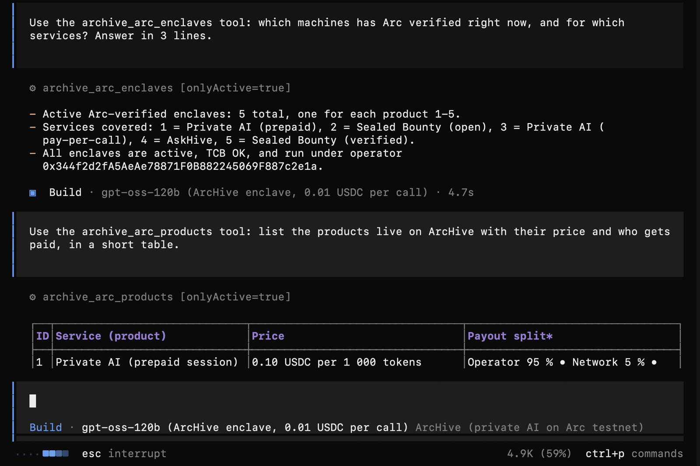
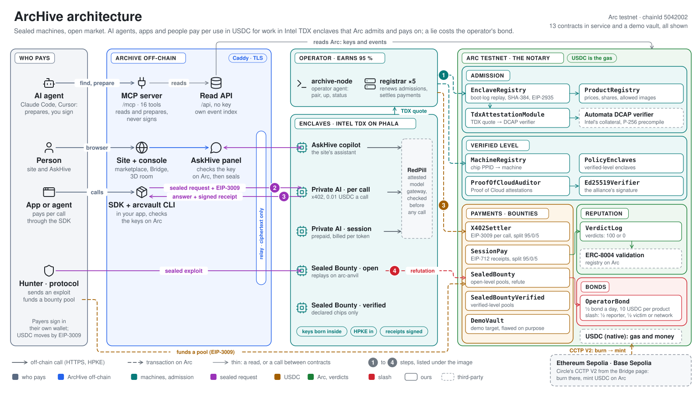

# ArcHive

· Main track: Agentic Payments and AI · Chain award: Best use of Arc

**Sealed machines, open market.** AI agents pay per use in USDC for compute on Intel TDX machines. Arc checks the machine before anyone is paid. A proven lie costs its operator's bond.

**Live:** https://arc-hive.xyz · **For AI agents:** [`/llms.txt`](https://arc-hive.xyz/llms.txt) and the [MCP server](docs/use-from-your-tools.md#the-mcp-server-in-claude-code-cursor-or-any-mcp-client), `https://arc-hive.xyz/mcp`

  
  

## Menu

| | |
|---|---|
| [Try it in two minutes](#try-it-in-two-minutes) | three checks, no wallet needed |
| [Services](#services) | the five products, who pays and how much |
| [Architecture](#architecture) | the diagram, in four steps |
| [How an AI agent pays](docs/agent-payments.md) | the agent's loop, x402 per call and prepaid sessions, the limits that cap its losses |
| [ArcHive on Arc, with Circle's tools](docs/arc-and-circle.md) | what we use from Arc and Circle, why, and what we left out |
| [How it works](docs/how-it-works.md) | how Arc verifies an enclave, AskHive in its enclave, the economics |
| [Use it from your tools](docs/use-from-your-tools.md) | the MCP server, the SDK, OpenCode (`opencode-arc`), Claude Code |
| [Proofs and contracts](docs/proofs-and-contracts.md) | every transaction and contract address on Arc testnet |
| [Run it](docs/run-it.md) | build, test, and the repository map |

## Try it in two minutes

1. **Arc refuses a wrong machine.** On https://arc-hive.xyz, in the *Arc check* section, press **Change one byte**: Arc recomputes the image fingerprint and refuses the machine. It's a read-only call, with no wallet.
2. **Ask AskHive**, in the Ask AskHive bar on the home page: *"Is this chat sealed in an enclave?"* It answers from its own enclave, admitted by Arc.
3. **Plug your agent in:** `claude mcp add --transport http archive https://arc-hive.xyz/mcp`, then ask it what runs on ArcHive.

*OpenCode runs on ArcHive's private AI (0.01 USDC per call) and reads the live network through our MCP server, added to its config.*

With a wallet: get test USDC at https://faucet.circle.com, then pay one 0.01 USDC call or open a prepaid session on the site.

## Services

Anyone can publish a service. These five are ours, live on Arc testnet.

| # | Service | Who pays | Price on testnet |
|---|---|---|---|
| 1 | Private AI, prepaid session | an app or a user | 0.10 USDC per 1,000 tokens, the rest refunded |
| 2 | Sealed Bounty | a protocol funds a pool | paid only for an exploit a sealed machine replayed |
| 3 | Private AI, pay per call (x402) | an AI agent, one signature, no gas | 0.01 USDC per call |
| 4 | AskHive, the site's assistant in its own enclave | free | — |
| 5 | Sealed Bounty, verified level | a protocol | as #2, on chips Arc and the Proof of Cloud alliance verified |

On each paid AI session or call, 95 % goes to the operator whose enclave served it and 5 % to the network. On a bounty payout, the hunter gets the whole tier, and the pool adds 10 % for the network and 5 % for the operator.

## Architecture

<a href="docs/img/architecture-light.svg">
  <picture>
    <source media="(prefers-color-scheme: dark)" srcset="docs/img/architecture-dark.svg">
    
  </picture>
</a>

1. **Arc admits the machine.** A contract checks Intel's signature on the machine's quote and the fingerprint of the exact image it runs.
2. **The agent pays per call.** It reads the enclave's key on Arc, seals its request to it, and signs one USDC authorization.
3. **The enclave answers with a signed receipt.** USDC moves only against that receipt, split in the same transaction.
4. **A lie costs the bond.** Two conflicting receipts, or a bounty claim that other enclaves refute by replay, seize the operator's USDC bond.

## What's next

- A second, independent operator, with our enclave images published.
- A first protocol funding a real Sealed Bounty.
- Mainnet: Intel's verifier first, then our contracts behind a multisig.

## Team

Jean-Baptiste Durand ([@JeanBaptisteDurand](https://github.com/JeanBaptisteDurand)) and Florent Belotti ([@FlorentBelotti](https://github.com/FlorentBelotti)), for UBC 2026. MIT [license](LICENSE).
