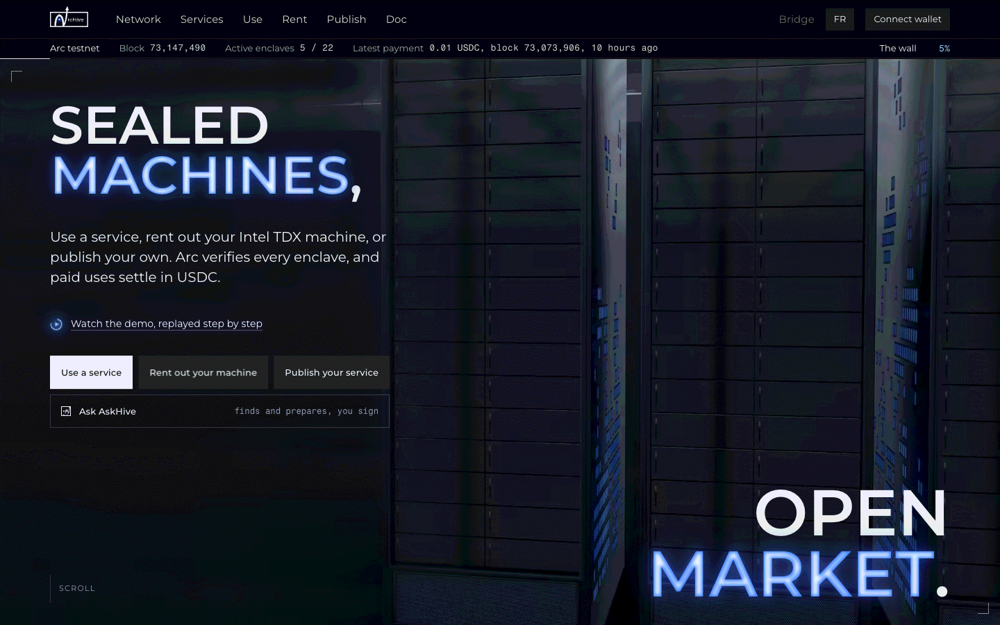

# ArcHive

Main track: Agentic Payments and AI · Chain award: Best use of Arc

**Sealed machines, open market.** ArcHive is a marketplace where AI agents and apps pay per use in USDC for compute on
Intel TDX machines that **Arc** verifies on-chain. Operators earn by renting out their machines, and authors by
publishing services.

**Who pays, who earns** (testnet prices, live at [`/api/products`](https://arc-hive.xyz/api/products)):

- An app that must keep its prompts private pays **0.10 USDC per 1,000 tokens** from a prepaid session (product 1).
- An AI agent pays **0.01 USDC per call**, with one signature and no gas (product 3, x402).
- A protocol funds a bug bounty that pays out only for an exploit a sealed machine replayed (products 2 and 5).
- The operator whose enclave served the request earns **95 %** of each paid call or session, and the network keeps 5 %.

**The problem.** An app or an AI agent that sends a private request to someone else's machine, or pays out on a
security report, has to take the provider's word: that the advertised code is what runs, that the data stays private,
that the result is honest. ArcHive replaces that word with checks Arc runs itself. A contract on Arc admits a machine
only once Intel's signature on it and the fingerprint of the exact image it runs check out. USDC moves only against a
receipt an admitted enclave signed, and a proven lie costs the operator's USDC bond. Others rate the payee after the
fact; ArcHive checks the machine before it pays anyone.

Built on Arc testnet for UBC 2026 by Jean-Baptiste Durand and Florent Belotti.

For an AI judge: [`/llms.txt`](https://arc-hive.xyz/llms.txt) restates all of this for a machine, and the
[MCP server](https://arc-hive.xyz/mcp) lets your agent read the live network itself. For a human, *Check it in two
minutes* below reaches the strongest proof without a wallet.

  
  

The home page and the Services page of https://arc-hive.xyz on 20 Nov 2026. On the Services page, each named sled of the
rack is a product with its live state; the others are open slots.

## In short

| | |
|---|---|
| **What** | A marketplace of services that run in Intel TDX enclaves, paid per use in USDC on Arc |
| **Why trust it** | A contract on Arc admits a machine only after checking Intel's signature and the exact image it runs; USDC is paid only against a receipt that enclave signed; a proven lie costs the operator's bond |
| **For AI agents** | An MCP server (16 tools), x402 pay per call (0.01 USDC), and even your coding agent's model (OpenCode via `opencode-arc`) |
| **Live** | https://arc-hive.xyz, on the v3 contracts, 5 enclaves admitted on Arc |
| **Proof** | Every step is a transaction on Arc testnet: [proofs and contracts](docs/proofs-and-contracts.md) |

**Contents:** [Live](#live) · [Check it in two minutes](#check-it-in-two-minutes) · [Services](#the-first-services-on-the-marketplace) · [Architecture](#architecture) · [More details](#more-details) · [What's next](#whats-next) · [Team](#team)

## Live

| What | Link |
|---|---|
| The marketplace | https://arc-hive.xyz |
| How it works in 3D (roles, contracts, a guided demo) | https://arc-hive.xyz/network.html |
| The services, prices and shares | https://arc-hive.xyz/service.html |
| The Doc: how Arc checks every machine, every proof linked | https://arc-hive.xyz/doc.html |
| Bring USDC to Arc with Circle's CCTP (from Ethereum Sepolia or Base Sepolia) | https://arc-hive.xyz/bridge.html |
| Console (sessions, bounties, operators, developers) | https://arc-hive.xyz/console/ |
| 3D server room (live, or a replay of recorded events) | https://arc-hive.xyz/datacenter/ |
| Read API (JSON, no key) | https://arc-hive.xyz/api/stats |
| MCP server for AI agents (16 tools, no key) | https://arc-hive.xyz/mcp |
| Arc testnet explorer | https://explorer.testnet.arc.io |

## Check it in two minutes

**No wallet, about 60 s:**

1. **Replay Arc's admission check.** On the home page, in the *Arc check* section ("Arc admits the enclave or refuses
   it"), press **Change one byte**. Arc recomputes the image fingerprint in a read-only call and refuses the machine.
2. **Ask AskHive** (bottom right of the site): *"Does this chat run in an enclave?"* The panel shows its connection to
   the enclave whose key Arc holds for product 4, and the answer comes back sealed by that enclave.
3. **Plug the MCP server into your agent**, then ask it what runs on ArcHive:
   `claude mcp add --transport http archive https://arc-hive.xyz/mcp`

**Without a browser:** `curl -s https://arc-hive.xyz/api/enclaves` lists what runs now, with the key of each enclave
Arc admitted. With Foundry's `cast`,
`cast receipt 0xde9628b23d0483bb666a0cd13c55c4f32a1204151323a80da9451b0aeb330176 --rpc-url https://rpc.testnet.arc.io`
shows AskHive's enclave admission: status 1 (success), 6,849,074 gas, sent to the `EnclaveRegistry`. Any transaction
below opens on the explorer at `https://explorer.testnet.arc.io/tx/<hash>`.

**Try it with a wallet:**

1. **Get test USDC** from https://faucet.circle.com: 20 USDC every 2 hours on Arc testnet, where USDC also pays the
   gas.
2. **Pay for one answer**: one 0.01 USDC call to product 3 from the console's pay-per-call chat
   (https://arc-hive.xyz/console/), or a prepaid session on product 1 from *My space* on
   https://arc-hive.xyz. The operator then settles it on Arc: 95 % to the operator and 5 % to the network, in one
   transaction.

## The first services on the marketplace

Anyone can publish a service; these five are ours.

| # | Product | Who pays | Who is paid | Contract | [Status](https://arc-hive.xyz/api/products) |
|---|---|---|---|---|---|
| 1 | Private AI, prepaid session | a user or an app deposits USDC, billed per token (0.10 USDC per 1,000 tokens on testnet) | operator 95 %, network 5 %; the rest is refunded | `SessionPay` | running |
| 2 | Sealed Bounty, open level | a protocol funds a USDC pool | the hunter gets 100 % of the tier; +10 % network and +5 % verifying operators, on top, only when paid | `SealedBounty` | running |
| 3 | Private AI, pay per call (x402) | an agent signs one EIP-3009 authorization per call (0.01 USDC per call) and pays no gas (the operator pays the settlement gas, about 0.005 USDC at 25 gwei) | operator 95 %, network 5 % | `X402Settler` | running |
| 4 | AskHive, the attested copilot | free | — | — | running |
| 5 | Sealed Bounty, verified level | a protocol funds a USDC pool | as product 2; only enclaves on chips declared by the Proof of Cloud alliance count | `SealedBountyVerified` | running |

*Running* means that an enclave admitted on Arc serves the product now. Prices, shares, bonds and delays are on-chain
parameters in `ProductRegistry` (who gets what: [Economic design](docs/how-it-works.md#economic-design-and-risk-assumptions)). Testnet
prices are set so that every flow shows on the explorer; they are not market prices. Live values:
[`/api/products`](https://arc-hive.xyz/api/products) for the parameters, [`/api/enclaves`](https://arc-hive.xyz/api/enclaves)
for the enclaves that serve each product.

## Architecture

<a href="docs/img/architecture-light.svg">
  <picture>
    <source media="(prefers-color-scheme: dark)" srcset="docs/img/architecture-dark.svg">
    
  </picture>
</a>

1. **Arc admits the machine.** The enclave gives a fresh TDX quote to its operator's registrar, which calls
   `EnclaveRegistry`. Arc checks Intel's signature through `TdxAttestationModule` and Automata's DCAP verifier, replays
   the boot log in SHA-384, and checks the image against `ProductRegistry`. For the verified level, the registrar also
   binds the chip in `MachineRegistry`. The registrar keeps the admission fresh.
2. **An agent pays per call.** It finds an enclave and its price with the MCP tools. Through the SDK, it reads the
   enclave's key on Arc and sends a request sealed to that key (HPKE), with one EIP-3009 authorization, through our
   relay. Our servers only relay ciphertext.
3. **The enclave answers with a signed receipt, and the operator settles.** The registrar settles on `X402Settler` (or
   `SessionPay`), which checks that an admitted enclave signed, reads the price and the shares, and splits the USDC
   95/0/5 in the same transaction. Sessions and bounties also write a verdict (100 or 0) through `VerdictLog` into the
   ERC-8004 validation registry on Arc; a paid call does not.
4. **A lie costs the bond.** Other bounty enclaves replay the claim on an `arc-anvil` fork of Arc and sign a
   refutation. `SealedBounty` then slashes the liar's bond in `OperatorBond`: half to the reporter, half to the victim.

Off-chain pieces:

- The read API (`services/api`) keeps its own index of contract events.
- One registrar per enclave (`services/registrar`) renews admissions and settles served sessions and paid calls.
- The copilot (`services/copilot`) runs on the server and, as AskHive, in its own enclave.
- The MCP server (`services/mcp`) gives any agent read tools, and prepare tools for bonds, registrations, bounties and
  products.
- The bounty enclave reaches Arc only through a strict relay. The relay re-hashes every block header, and the enclave
  signs nothing that depends on an RPC error.

## More details

- [How it works](docs/how-it-works.md): how Arc verifies an enclave, how ArcHive uses Arc, AskHive in its enclave, the agent's decision loop and safety limits, the economics.
- [Use ArcHive from your own tools](docs/use-from-your-tools.md): the MCP server, the SDK and CLI, OpenCode and any OpenAI-compatible tool, Claude Code.
- [Proofs and contracts](docs/proofs-and-contracts.md): every transaction and every contract address on Arc testnet.
- [Run it](docs/run-it.md): build and test each part, and the repository map.

## History

The earlier contract sets and their proofs are in [`docs/history.md`](docs/history.md).

## What's next

- **The v3 switch.** Move the site, the API and the enclaves to the v3 stack, already deployed, after the hackathon.
- **A budget on the buyer's side.** Accept smart-account payers in the enclave (ERC-1271), so an agent's spending
  rules can live in an EIP-7702 smart account or in ERC-7715 / ERC-7710 delegated permissions, on top of today's
  per-call cap.
- **Circle Agent Wallets** for buying agents, with daily limits.
- **Circle Nanopayments** for sub-cent calls, with each batch still tied to the enclaves' signed receipts.
- **Product 3 in Circle's Agent Marketplace**, once it speaks x402 v2.
- **ERC-8183 job escrow**, for longer agent jobs that an admitted enclave completes and signs.
- **A second operator.** Publish the enclave images, so any operator can run the allowed fingerprints, and bring in a
  second, independent operator.
- **Mainnet.** Intel's verifier first, then the contracts behind a 2-of-3 multisig and 48-hour timelocks.
- **The developer kit.** Streaming in the `arcvault` proxy, so Claude Code can use a prepaid session behind the
  gateway, and the SDK and the CLI on npm.

## Feedback for Arc and Circle

- Arc Foundry's `arc-anvil` made exact exploit replays possible: plain anvil cannot reproduce Arc's native USDC.
- Arc's P-256 precompile is what makes on-chain DCAP affordable.
- Two asks: an Arc RPC that serves historical `eth_getProof`, and Intel's DCAP verifier on Arc mainnet as a shared
  public good.

## License

MIT, see [LICENSE](LICENSE). Vendored third-party code keeps its own license and records its exact upstream commit:
[solady](contracts/lib/solady-0.0.160/VENDORED.md) and [Smooth CryptoLib](contracts/lib/smooth-crypto-lib/VENDORED.md).

## Team

- Jean-Baptiste Durand ([@JeanBaptisteDurand](https://github.com/JeanBaptisteDurand))
- Florent Belotti ([@FlorentBelotti](https://github.com/FlorentBelotti))
